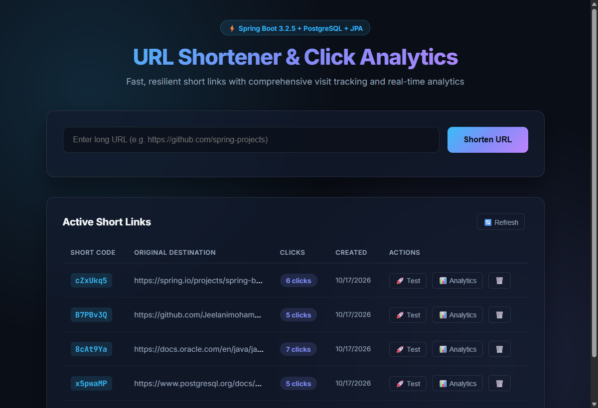
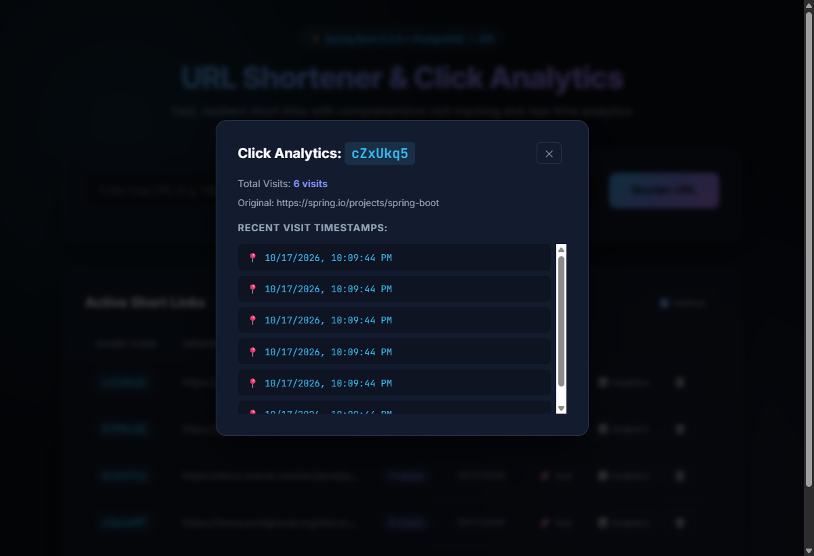

# 🔗 URL Shortener with Click Analytics

A clean, production-ready Spring Boot backend and web dashboard that converts long URLs into unique short links, performs HTTP 302 redirections, and tracks comprehensive click analytics in PostgreSQL.

---

## 📸 Project Screenshots

### 1. Web Dashboard & Short Link Management


### 2. Click Analytics & Timestamp History


---

## ✨ Features

- **Unique Short Codes**: Generates 7-character alphanumeric codes via cryptographically secure `SecureRandom`.
- **Collision Resilience**: Automatic retry mechanism to prevent duplicate short-code conflicts.
- **Deduplication**: Idempotent URL creation returns existing short links for identical destination URLs.
- **Safe HTTP 302 Redirection**: Ensures every link visit is tracked without aggressive browser caching.
- **Database-Backed Analytics**: Stores visit counts and precise click timestamps in PostgreSQL.
- **Input Validation**: Rejects empty inputs, malformed URLs, and non-HTTP/HTTPS protocols.
- **Centralized Error Handling**: Uniform JSON error responses via `@RestControllerAdvice`.
- **Unit Tested**: Comprehensive test suite covering business logic with JUnit 5 & Mockito.

---

## 🏛️ Application Architecture

```
┌─────────────┐   HTTP Request    ┌────────────────┐   Service Call   ┌──────────────────────┐
│   Client    │ ────────────────► │   Controller   │ ───────────────► │       Service        │
│  (Browser/  │                   │  UrlController │                  │ UrlShortenerService  │
│  Postman)   │                   │  RedirectCtrl  │                  │ CodeGeneratorService │
└─────────────┘                   └────────────────┘                  │ UrlValidationService │
                                                                       └──────────┬───────────┘
                                                                                  │
                                                                       ┌──────────▼───────────┐
                                                                       │      Repository      │
                                                                       │  ShortUrlRepository  │
                                                                       │ ClickEventRepository │
                                                                       └──────────┬───────────┘
                                                                                  │ JPA/Hibernate
                                                                       ┌──────────▼───────────┐
                                                                       │ PostgreSQL Database  │
                                                                       │   - short_urls       │
                                                                       │   - click_events     │
                                                                       └──────────────────────┘
```

---

## 🛠️ Technology Stack

- **Language**: Java 17
- **Backend Framework**: Spring Boot 3.2.5
- **Database**: PostgreSQL
- **ORM / Persistence**: Spring Data JPA & Hibernate
- **Validation**: Jakarta Bean Validation
- **Testing**: JUnit 5 & Mockito
- **Build Tool**: Maven

---

## 🗄️ Database Design

### `short_urls`
| Column | Type | Constraints | Description |
|---|---|---|---|
| `id` | `BIGSERIAL` | `PRIMARY KEY` | Auto-incrementing identifier |
| `original_url` | `VARCHAR(2048)` | `NOT NULL` | Original long destination URL |
| `short_code` | `VARCHAR(10)` | `NOT NULL, UNIQUE` | Unique 7-character code |
| `created_at` | `TIMESTAMP` | `NOT NULL` | Record creation timestamp |
| `click_count` | `BIGINT` | `NOT NULL, DEFAULT 0` | Total visit counter |

### `click_events`
| Column | Type | Constraints | Description |
|---|---|---|---|
| `id` | `BIGSERIAL` | `PRIMARY KEY` | Auto-incrementing identifier |
| `short_url_id` | `BIGINT` | `FOREIGN KEY` | Reference to parent `short_urls(id)` |
| `clicked_at` | `TIMESTAMP` | `NOT NULL` | Individual visit timestamp |

---

## 🚀 Setup & Execution

### 1. Prerequisites
- **Java 17+**
- **Maven 3.9+**
- **PostgreSQL 15+**

### 2. Database Configuration
Create the database in PostgreSQL:
```sql
CREATE DATABASE url_shortener_db;
```

Update credentials in `src/main/resources/application.properties` (or set environment variables):
```properties
spring.datasource.url=jdbc:postgresql://localhost:5432/url_shortener_db
spring.datasource.username=${DB_USERNAME:postgres}
spring.datasource.password=${DB_PASSWORD:postgres}
server.port=${SERVER_PORT:8082}
```

### 3. Run the Application
```bash
mvn clean spring-boot:run
```
Access the application dashboard at: **`http://localhost:8082`**

---

## 📡 REST API Reference

### 1. Create Short URL
- **Endpoint**: `POST /api/urls`
- **Request Body**:
  ```json
  {
    "originalUrl": "https://spring.io/projects/spring-boot"
  }
  ```
- **Response (201 Created)**:
  ```json
  {
    "id": 1,
    "originalUrl": "https://spring.io/projects/spring-boot",
    "shortCode": "cZxUkq5",
    "shortUrl": "http://localhost:8082/cZxUkq5",
    "createdAt": "2026-10-17T22:00:00",
    "clickCount": 0
  }
  ```

### 2. Get Short URL Details
- **Endpoint**: `GET /api/urls/{shortCode}`
- **Response (200 OK)**:
  ```json
  {
    "id": 1,
    "originalUrl": "https://spring.io/projects/spring-boot",
    "shortCode": "cZxUkq5",
    "shortUrl": "http://localhost:8082/cZxUkq5",
    "createdAt": "2026-10-17T22:00:00",
    "clickCount": 6
  }
  ```

### 3. List All Short URLs
- **Endpoint**: `GET /api/urls`
- **Response (200 OK)**: Array of short URL objects.

### 4. Delete Short URL
- **Endpoint**: `DELETE /api/urls/{shortCode}`
- **Response**: `204 No Content`

### 5. URL Redirection
- **Endpoint**: `GET /{shortCode}`
- **Response**: `302 Found` with `Location: <originalUrl>` (Click count increments and timestamp is logged).

### 6. Get Click Analytics
- **Endpoint**: `GET /api/urls/{shortCode}/analytics`
- **Response (200 OK)**:
  ```json
  {
    "shortCode": "cZxUkq5",
    "originalUrl": "https://spring.io/projects/spring-boot",
    "shortUrl": "http://localhost:8082/cZxUkq5",
    "createdAt": "2026-10-17T22:00:00",
    "totalClicks": 6,
    "clickHistory": [
      "2026-10-17T22:05:12",
      "2026-10-17T22:06:45"
    ]
  }
  ```

---

## 🧪 Running Unit Tests

Run the full JUnit 5 and Mockito test suite via Maven:
```bash
mvn test
```
All business logic, collision handling, deduplication, and input validation are verified without requiring an active database connection.

---

## 📁 Project Structure

```
url-shortener-click-analytics/
├── screenshots/
│   ├── dashboard.png
│   └── analytics_modal.png
├── src/
│   ├── main/
│   │   ├── java/com/urlshortener/
│   │   │   ├── UrlShortenerApplication.java
│   │   │   ├── config/AppConfig.java
│   │   │   ├── controller/
│   │   │   │   ├── UrlController.java
│   │   │   │   └── RedirectController.java
│   │   │   ├── dto/
│   │   │   │   ├── AnalyticsResponse.java
│   │   │   │   ├── CreateUrlRequest.java
│   │   │   │   ├── ErrorResponse.java
│   │   │   │   └── UrlResponse.java
│   │   │   ├── entity/
│   │   │   │   ├── ClickEvent.java
│   │   │   │   └── ShortUrl.java
│   │   │   ├── exception/
│   │   │   │   ├── GlobalExceptionHandler.java
│   │   │   │   ├── InvalidUrlException.java
│   │   │   │   └── ShortCodeNotFoundException.java
│   │   │   ├── repository/
│   │   │   │   ├── ClickEventRepository.java
│   │   │   │   └── ShortUrlRepository.java
│   │   │   └── service/
│   │   │       ├── ShortCodeGeneratorService.java
│   │   │       ├── UrlShortenerService.java
│   │   │       └── UrlValidationService.java
│   │   └── resources/
│   │       ├── application.properties
│   │       └── static/index.html
│   └── test/java/com/urlshortener/service/
│       ├── ShortCodeGeneratorServiceTest.java
│       ├── UrlShortenerServiceTest.java
│       └── UrlValidationServiceTest.java
├── .gitignore
├── pom.xml
└── README.md
```
